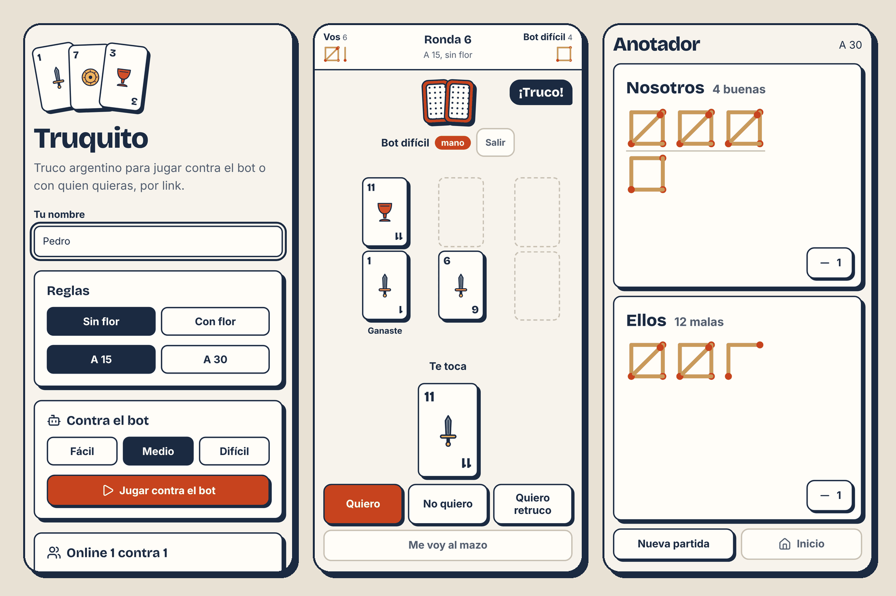
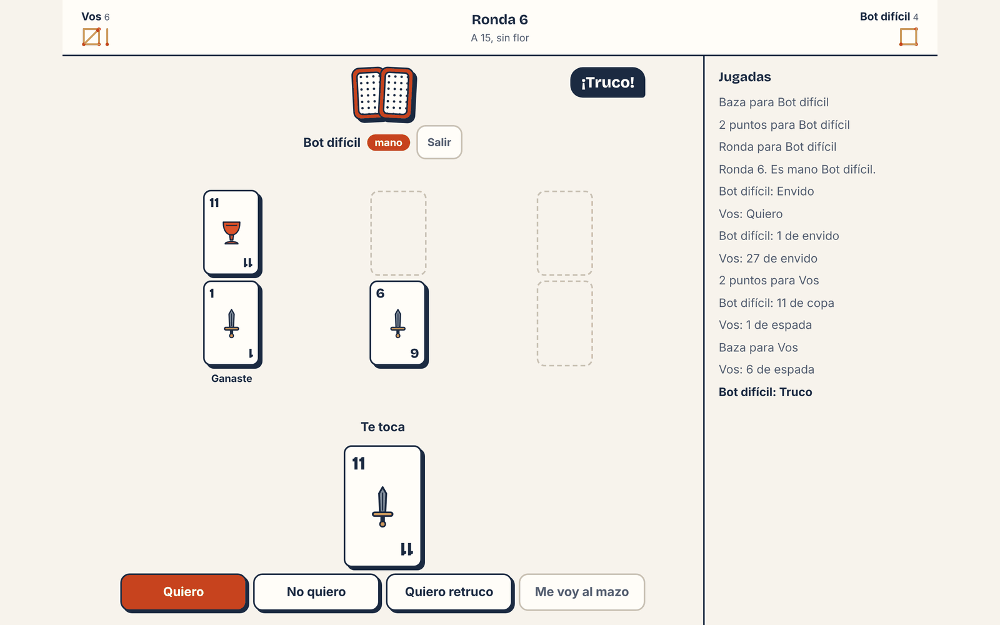
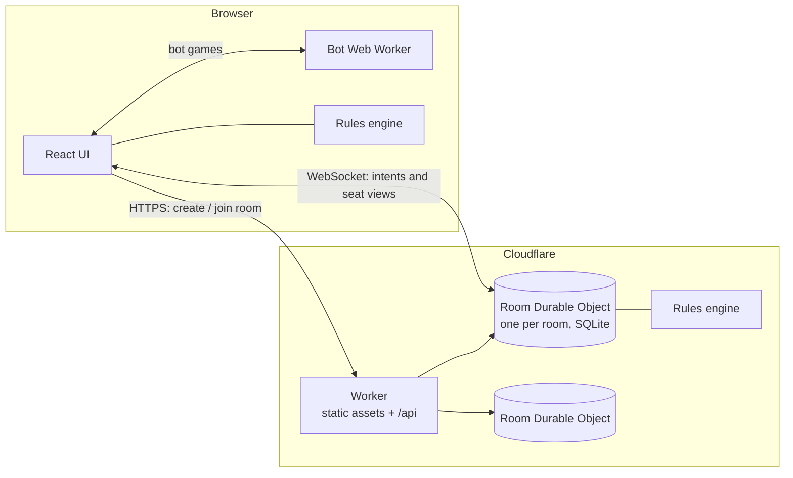

# Truquito

Argentine truco in the browser, against a bot or one on one with a friend through a private link.

[](https://github.com/pedrolaino/truquito/actions/workflows/ci.yml)
[](LICENSE)

**Play it at [truquito.pedrolaino.workers.dev](https://truquito.pedrolaino.workers.dev)**



## Features

- Play against a bot on easy, medium or hard. Bot games run in your browser.
- Play online 1 on 1: create a room, send the link, and the game starts when your friend joins. Players only need a name.
- If your connection drops, reopening the link gives you your seat back. Your opponent sees that you are away and wins by abandonment after two minutes.
- Both players can ask for a rematch in the same room.
- Each room is played with or without flor, to 15 or 30 points. At 30 the score reads as _malas_ and _buenas_.
- The scorekeeper keeps the score of a game with real cards: tap _Nosotros_ or _Ellos_ to add a point. It draws the score with matchsticks, four in a square and a fifth across it, the way Argentine players keep score.
- For _puntas_, a popup over the scorekeeper counts each team's points on their own; when you finish, the difference goes to the team that made more.
- New to truco? _Aprender a jugar_ has a quick guide (the card ranking, how to count envido and what each call is worth), nine short lessons with quizzes and hands to play, and a practice game against the easy bot where a coach suggests each move and says why. The guide is also one tap away during any game.
- The layout is designed for phones first. You can play with a keyboard, screen readers announce every call and card, and the animations switch off when your system asks for reduced motion.



## Rules in this implementation

Truco rules vary from one table to the next. Truquito plays by these.

### Deck

Spanish 40-card deck (no 8s, 9s or jokers). From highest to lowest: 1 of espada, 1 of basto, 7 of espada, 7 of oro, the 3s, the 2s, 1 of oro and 1 of copa, the 12s, 11s and 10s, 7 of basto and 7 of copa, the 6s, 5s and 4s. Cards of the same level tie (_parda_).

### Rounds and tricks

Each player gets three cards; the first _mano_ is drawn at random and then it alternates. Two tricks win the round. The winner of a trick leads the next one, and after a parda the mano leads. If the first trick is a parda the second decides; if the second is also a parda the third decides; three pardas go to the mano. A parda after one player won the first trick goes to that player, and so does a parda in the third trick when each player won one. The round ends as soon as it is decided.

### Envido

Two cards of the same suit are worth 20 plus both cards (1 to 7 count their number, figures count 0); otherwise the highest card counts. With three of a suit and flor off, the two highest count. It can only be called in the first trick, by each player before playing their first card, and it comes first: if truco is called before you played, you can answer with envido and then answer the truco.

- Envido is worth 2 (at most twice in a row), real envido 3, falta envido what the leader needs to finish. After real envido only falta envido can follow, and after falta envido only quiero or no quiero.
- Accepted: all calls add up, or only the falta envido if there is one.
- Declined: the last caller gets what was on the table before their call, or 1 if it was the first call.
- Points are compared automatically. The mano speaks first; the other player shows their points only if they are higher, otherwise they say _son buenas_. The mano wins ties.

### Flor

Only in rooms that play with flor. A player with three cards of the same suit sings flor automatically, and nobody can call envido that round. A single flor scores 3; with two flores the higher one (20 plus the three cards, mano wins ties) scores 6. Truquito leaves out contraflor and contraflor al resto to keep the rules short.

### Truco

Truco is worth 2, retruco 3 and vale cuatro 4; a round without truco is worth 1. Declined, the caller gets the previous value. Only the player who accepted the last call can raise, either while answering ("quiero retruco") or later on their turn. No cards are played while a call is waiting for an answer. Nobody calls truco on a 4: while the opponent's 4 is on the table, you cannot call or raise until you play your card.

### Irse al mazo

You can go to the mazo on your turn or instead of answering a call. The opponent scores what the round is worth at that moment, and pending calls count as declined.

### Score

Each player scores as soon as a call or a round is settled, and the game ends the moment someone reaches the target, even in the middle of a round.

## How the bots work

A bot is a function that gets only its seat's view and the list of legal actions, never the full game state, so it knows what a person in its seat would know.

- Easy plays half its cards at random and only wants the envido with 27 or more. It answers a truco by its chances of winning, but reads them loosely.
- Medium plays like an average player. It knows its envido, wins each trick with the lowest card that is enough, and weighs a truco by playing the round out against two dozen hands the opponent could hold, so a card already on the table counts. Now and then it bluffs.
- Hard uses determinization. It builds every hand the opponent could hold given what it has seen (cards played, announced points or "son buenas", whether they sang flor), samples 40 of them, plays each legal action to the end of the round in every sample and keeps the action that scores best. The number of samples is fixed, so it does not depend on how fast the device is.

Bots wait between 0.6 and 1.4 seconds before each move, about as long as a person takes to think.

`npm run benchmark` plays bot against bot with a fixed seed, to 15 points without flor, swapping seats every game. With 1000 games per pairing:

| Pairing        | Win rate |
| -------------- | -------- |
| Medium vs easy | 74.7%    |
| Hard vs easy   | 64.2%    |
| Hard vs medium | 60.5%    |

Hard simulates its opponent as a medium player who accepts any envido with 26 or more, so it is at its best against players who think like that. Easy reads its hand loosely and plays half its cards at random, which hard does not model, so medium beats it more often than hard does.

## Tech stack

- TypeScript in strict mode everywhere
- React and Vite for the client
- Cloudflare Workers and Durable Objects (SQLite storage, hibernating WebSockets) for online rooms
- Vitest, the Workers Vitest integration and Playwright for tests
- ESLint and Prettier
- Bricolage Grotesque and Inter, self-hosted; Lucide icons; card art drawn as our own SVG

## Architecture



### One rules engine

`src/engine` is a set of pure functions with no React or Cloudflare imports: create a game from its settings and a seed, list the legal actions for a seat, apply an action (returning the new state and the events, or an error) and build the view for a seat. The state is plain JSON and randomness comes from a seed stored in it (Mulberry32 with a Fisher–Yates shuffle), so any game can be replayed in tests. Players are a list of seats rather than "player 1" and "player 2" so team games can be added later.

### Bots run in the browser

On the free Workers plan each request gets 10 ms of CPU, and a hard bot decision can take longer. Against a bot there is also nobody to cheat, so bot games never touch the server and do not use the free quota. The hard bot takes about 20 ms per decision on a desktop and up to around half a second on a CPU throttled six times, which would freeze the page on a slow phone, so bots run in a Web Worker.

### The opponent's cards stay on the server

In online games the browser only sends intents ("play this card", "truco", "quiero"). The room's Durable Object checks each one with the engine, saves the state and sends each player their own view, built by `viewFor`, which drops the other player's hand and the random seed. The opponent's unplayed cards never reach your browser, so nobody can read them from the page or the network traffic. Property tests play thousands of random games and check that no view ever contains one.

### Rooms

Each room is a Durable Object addressed by a random 128-bit id, which is also the link. Every player gets a random token stored in the browser; the WebSocket authenticates with it and the seat is attached to the connection, so a player who comes back with the token gets their seat back. Messages are JSON, size-limited and validated by hand-written parsers, and every state carries a sequence number so stale messages are dropped. Reconnection deadlines and the cleanup of rooms idle for 24 hours run on Durable Object alarms. There are per-connection message limits and a per-client limit on creating rooms.

## Project structure

```
src/
  engine/   rules, cards, seeded shuffle (pure TypeScript)
  bots/     easy, medium and hard bots, bot vs bot matches
  shared/   config and the online protocol
  worker/   Worker entry and the room Durable Object
  client/   React app, bot Web Worker, styles
    learn/  guide, lessons and the coach
e2e/        Playwright tests
scripts/    benchmark
```

All tunable numbers (bot delays, hard bot samples, reconnection window, limits) live in `src/shared/config.ts`.

## Getting started

You need Node.js 22.

```bash
npm install
npm run dev
```

`npm run dev` serves the client and runs the Worker and Durable Objects locally through the Cloudflare Vite plugin, so online rooms work on your machine. To test a production build:

```bash
npm run build
npm run preview
```

## Tests

```bash
npm test          # engine, bots, client logic and the Durable Object
npm run e2e       # Playwright on mobile and desktop
npm run lint      # ESLint and Prettier
npm run typecheck
```

- Engine tests cover the card ranking, every parda case, envido and flor points, each call accepted and declined, invalid raises, envido before truco, falta envido, going to the mazo with pending calls and the game ending mid-round.
- Property tests play 2000 random games checking that the deck has 40 unique cards, nobody plays a card they do not have, every game ends and no view leaks unplayed cards.
- A smaller bot test checks that hard beats medium and medium beats easy.
- Lesson tests play every scripted hand through the engine, and coach tests check that its advice is legal over 200 random games.
- The Durable Object tests cover joining, playing, reconnecting, abandonment, eviction, rematch, cleanup and invalid messages.
- End-to-end tests play a full game against the hard bot, a full online game with a rematch across two browser contexts, a reconnection after closing one of them, the scorekeeper with puntas, and every lesson from start to end.

CI runs lint, typecheck, tests, build and the end-to-end tests on every pull request.

## Deploy

The app is one Worker that serves the client and the API. Cloudflare Workers Builds deploys it from `main` with `npm run build` and `npx wrangler deploy`; builds for other branches are off, and the GitHub workflow never deploys. Everything fits in the Workers free plan. To deploy your own copy, connect the repository in Workers Builds with those commands, or run them yourself after `npx wrangler login`.

## License

[MIT](LICENSE)
